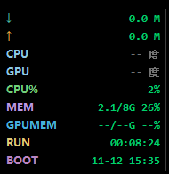
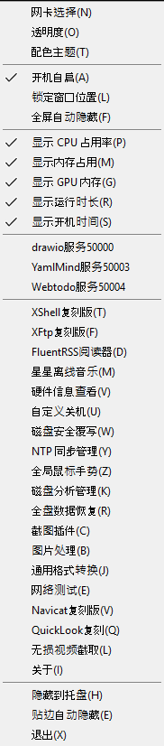
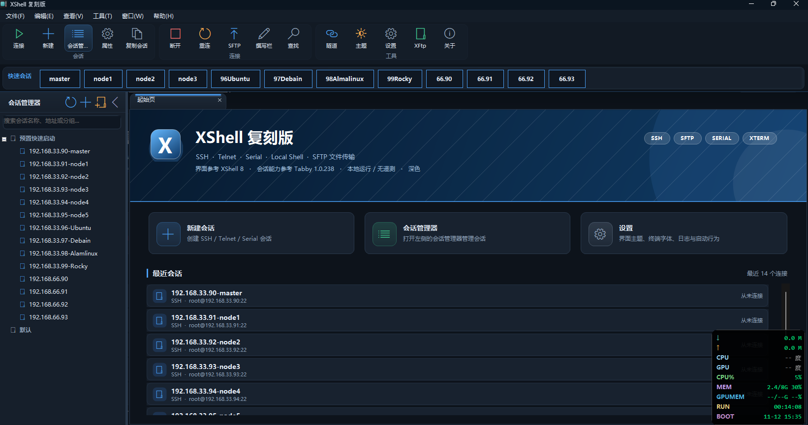
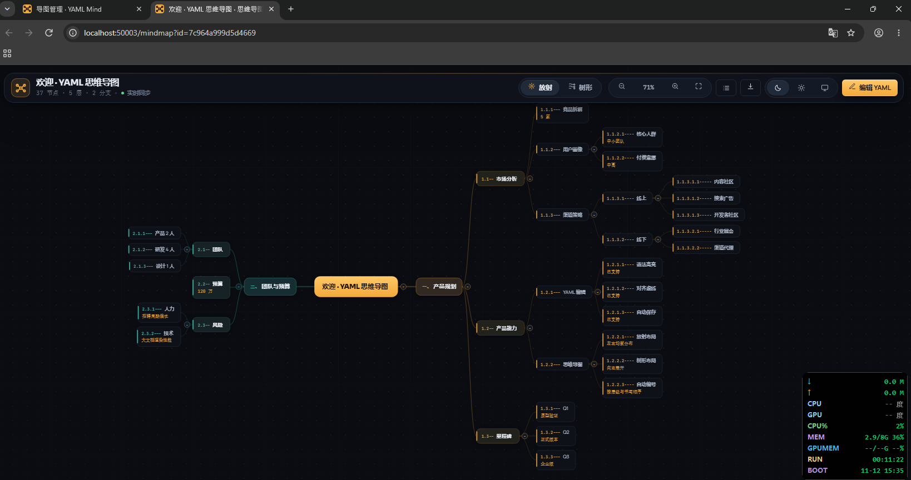
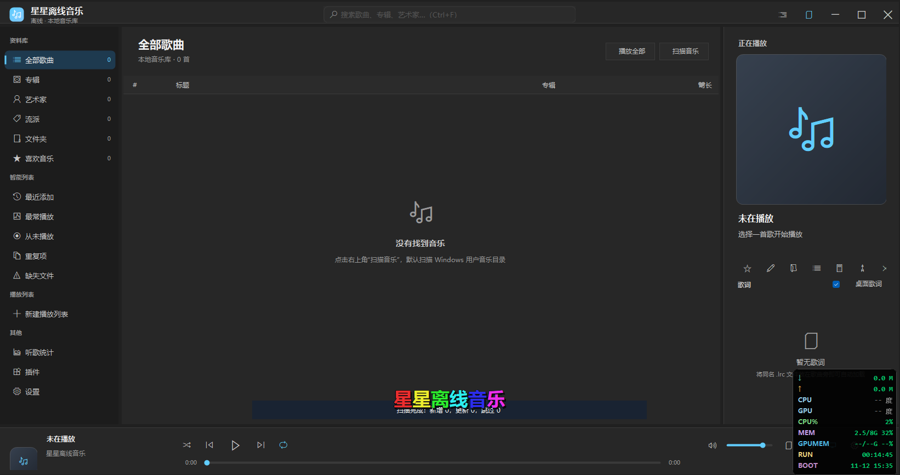
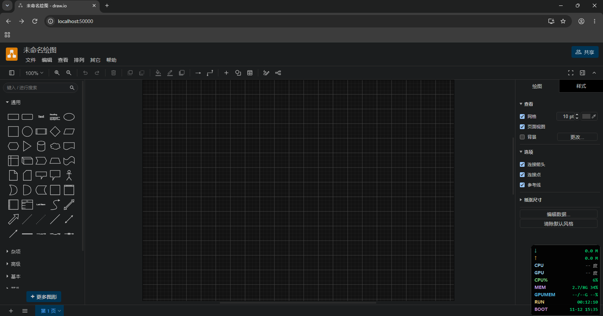

<div align="center">

# MiniMonitor

**Windows 置顶悬浮窗监控 · 一体化桌面工具箱**

一个类似 TrafficMonitor 的圆角悬浮窗，只显示你最关心的几项指标；
右键菜单里却藏着一整套终端、网络、数据恢复、图像、数据库与 Web 服务工具。

[](https://github.com/MzSSLF8VKr/MiniMonitor/releases/latest)
[](https://github.com/MzSSLF8VKr/MiniMonitor/actions/workflows/build.yml)
[](#下载与安装)
[](#从源码构建)
[](https://github.com/MzSSLF8VKr/MiniMonitor/releases)

<table>
  <tr>
    <td align="center"><br><sub>置顶悬浮窗：网速 / 温度 / 占用 / 运行时长</sub></td>
    <td align="center"><br><sub>右键菜单：全部工具一键直达</sub></td>
  </tr>
</table>

</div>

---

## 简介

MiniMonitor 是一个**单文件、免安装**的 Windows 桌面工具：屏幕上常驻一个圆角小窗，实时显示下载/上传速度（MB/s）、CPU/GPU 温度、CPU 占用、内存与显存占用、运行时长和开机时间；支持 5 套配色、4 档透明度、全屏自动隐藏、贴边隐藏、开机自启。

悬浮窗之外，它内置了一整套按需打开的工具（默认不占任何界面）：XShell 风格终端与 SFTP、十合一网络测试、全盘数据恢复、截图/录屏 + 离线 OCR、图片处理与格式转换、无损视频剪切、离线音乐播放器、Navicat 风格数据库管理、FluentRSS 阅读器，以及 draw.io / YamlMind 思维导图 / WebTodo 三个仅监听本机回环的内置 Web 服务。

编译产物为**自包含单文件 exe**（内嵌 .NET 运行时），目标机器无需安装任何运行时。

## 界面预览

| XShell 复刻版（SSH / Telnet / 串口 / 本地 Shell） | YamlMind 思维导图服务 |
|:---:|:---:|
|  |  |

| 离线音乐播放器 | 图片处理（单张 / 证件照 / 批量 / 打印 / EXIF） |
|:---:|:---:|
|  |  |

| 内置 draw.io 绘图服务 | |
|:---:|:---:|
|  | |

## 功能亮点

- **悬浮窗监控**：网速按 MB/s 显示（自动累加物理网卡、排除虚拟网卡）；温度多路径回退读取（LibreHardwareMonitor → WMI 性能计数器 → WMI ACPI 热区 / nvidia-smi），兼容 Win10 / 11 / Server 2016–2025；≥75℃ 橙色、≥85℃ 红色预警
- **终端与传输**：XShell 复刻版（多标签终端、会话管理、跳板机、端口隧道、独立 SFTP 双栏窗口）；XFtp 客户端（FTP / FTPS / SFTP、拖拽上传下载、传输队列）
- **网络测试十合一**：TCPing、Traceroute（国家/地区标注）、Telnet、内置 Nmap 引擎、PingInfoView、WirelessNetworkWatcher、BluetoothView、蓝屏查看器、TCP/UDP 实时监视、快捷键注册列表
- **数据与磁盘**：全盘数据恢复（Kickass Undelete / FreeRecover / TestDisk / PhotoRec / WinfrGUI 五引擎）、磁盘分析矩形图、磁盘安全覆写（DoD / Gutmann / AES-256 预覆盖）、自定义关机
- **图像与媒体**：矩形/滚动截图、录屏（MP4/GIF）、图像编辑器 + Windows 离线 OCR（按原图排版重建）；证件照换底、批量处理、照片打印、EXIF 剔除；通用格式转换；LosslessCut 风格无损视频剪切；全离线音乐播放器（歌词 / EQ / 迷你播放器 / 桌面歌词）
- **数据库管理**：Navicat 复刻版，MySQL / PostgreSQL / SQL Server / Oracle / SQLite 驱动全内嵌，SQL 编辑器、表设计器、导入导出、备份还原、ER 图、计划任务
- **内置 Web 服务**（默认关闭，仅 127.0.0.1）：draw.io 32.6.10（端口 50000）、YamlMind 思维导图（50003）、WebTodo 待办（50004）
- **效率增强**：FluentRSS 三栏阅读器、QuickLook 空格预览、硬件信息查看（精简/详细）、NTP 自动校时、全局鼠标手势

> 完整功能说明、温度读取原理、常见问题与源码结构见 **[docs/FEATURES.md](docs/FEATURES.md)**。

## 下载与安装

前往 **[Releases 页面](https://github.com/MzSSLF8VKr/MiniMonitor/releases/latest)** 下载最新版本的以下资产：

| 资产 | 说明 |
|---|---|
| `MiniMonitor-v<版本>-win-x64.exe` | 自包含单文件程序，双击即用（建议右键"以管理员身份运行"） |
| `MiniMonitor-v<版本>-source.zip` | 完整源码包（与仓库 tag 内容一致） |
| `SHA256SUMS.txt` | 上述两个文件的 SHA256 校验值 |
| `*.sha256` | 单个文件对应的校验值 |

**校验下载完整性**（PowerShell）：

```powershell
Get-FileHash .\MiniMonitor-v1.66.4-win-x64.exe -Algorithm SHA256
# 将输出的 Hash 与 SHA256SUMS.txt 中对应行比对（不区分大小写）
```

运行要求：Windows 10 / 11 / Server 2016+ x64。终端与 RSS 等界面依赖 Microsoft Edge WebView2 Runtime（Win10/11 随 Edge 自带）；视频相关功能可选配 ffmpeg.exe。首次运行如弹 UAC 属正常现象（温度读取需要管理员权限），拒绝后温度自动走 WMI 后备通道。

## 自动化构建（GitHub Actions）

本仓库的发布完全由 GitHub Actions 自动完成，无需本地手工打包：

- 推送 `v*` 标签（或在 Actions 页面手动触发 **Release** 工作流）后，`windows-latest` runner 自动执行：
  1. `dotnet publish` 生成自包含单文件 `MiniMonitor.exe`；
  2. `git archive` 打包当前 tag 的完整源码为 zip；
  3. 计算 exe 与源码包的 **SHA256**，生成 `SHA256SUMS.txt` 与单文件 `.sha256`；
  4. 创建 GitHub Release 并上传全部资产。
- 每次推送到 `main` 或提交 PR 时，**Build** 工作流会自动编译验证，保证源码始终可构建。

工作流定义见 [`.github/workflows/release.yml`](.github/workflows/release.yml) 与 [`.github/workflows/build.yml`](.github/workflows/build.yml)。

## 从源码构建

需要 [.NET 8 SDK](https://dotnet.microsoft.com/download/dotnet/8.0)。

**方式一（Windows 一键）**：双击 `build.bat`，自动还原 NuGet 依赖并发布单文件 exe（失败自动重试）。

**方式二（命令行，任意平台可交叉编译）**：

```bash
dotnet publish MiniMonitor.csproj -c Release -r win-x64 --self-contained true \
  -p:PublishSingleFile=true -p:IncludeNativeLibrariesForSelfExtract=true \
  -p:EnableCompressionInSingleFile=true -p:DebugType=None -p:DebugSymbols=false
```

产物位于 `bin/Release/net8.0-windows10.0.19041.0/win-x64/publish/MiniMonitor.exe`（约 150 MB，自包含运行时）。也可用 Visual Studio 2022（".NET 桌面开发"工作负载）直接打开 `MiniMonitor.csproj`。

## 第三方组件与声明

本程序内嵌或引用了以下开源组件，版权归各自作者所有：draw.io（Apache-2.0）、DB-IP Lite 国家库（CC BY 4.0）、IEEE OUI 数据库、xterm.js（MIT）、LibreHardwareMonitor（MPL-2.0）、NAudio（MIT）、TagLib#（LGPL-2.1）、SSH.NET（MIT）、MailKit（MIT）、YamlDotNet（MIT）等。

XShell / Xftp / Navicat / Fluent Reader / WaveFlow / LosslessCut / NirSoft 系列等均为**独立实现的界面兼容复刻**，不包含任何原厂代码，与原厂无关联；相关商标归原公司所有。

## 许可

本项目源码公开供学习与个人使用。内嵌第三方资源遵循其各自许可证（见上节）。